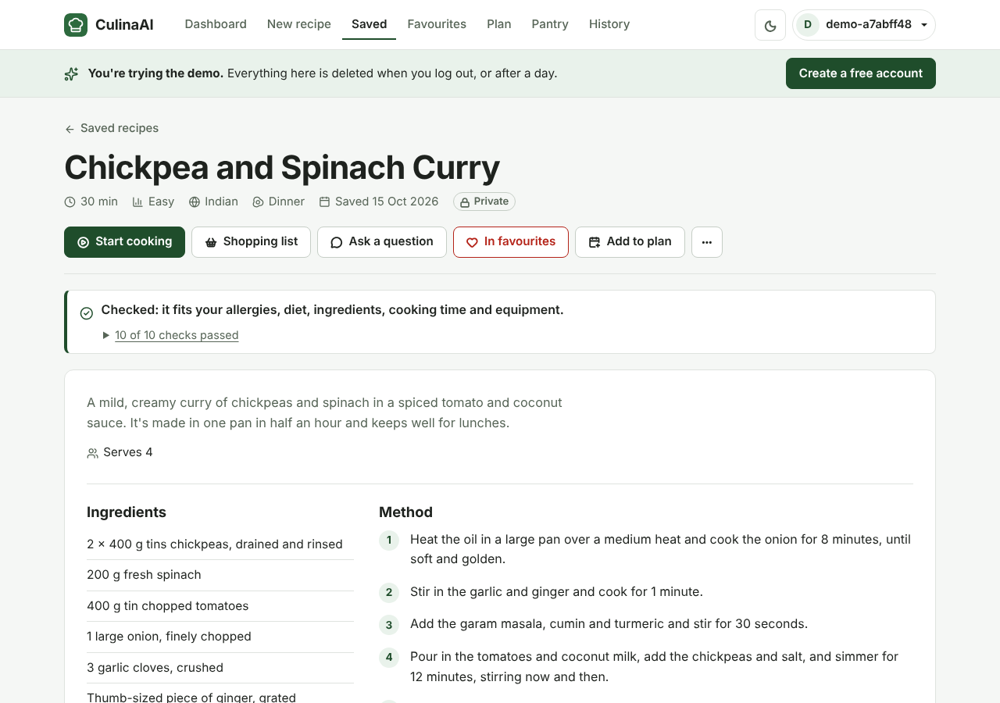
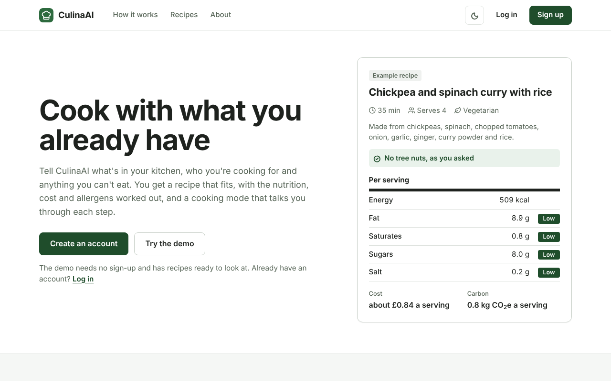
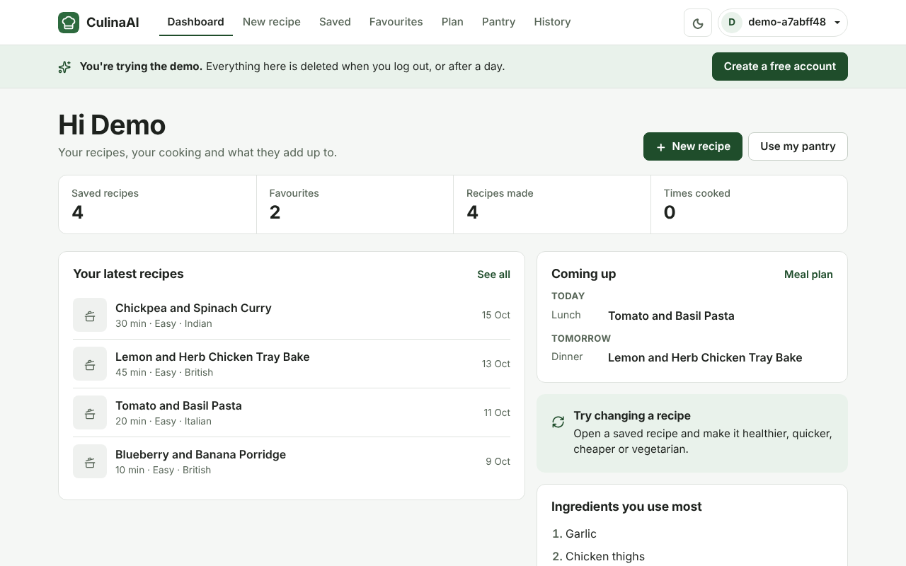
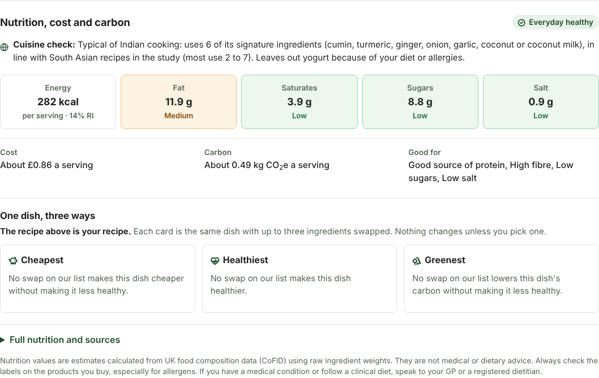
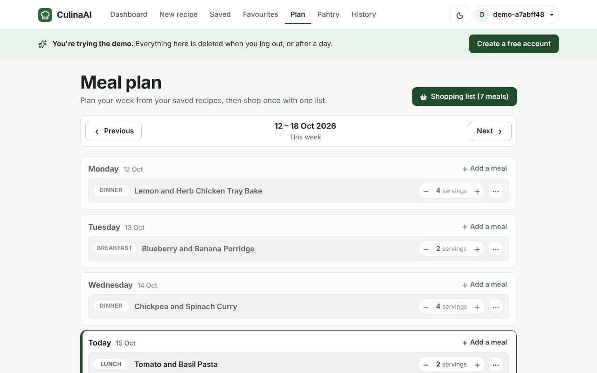
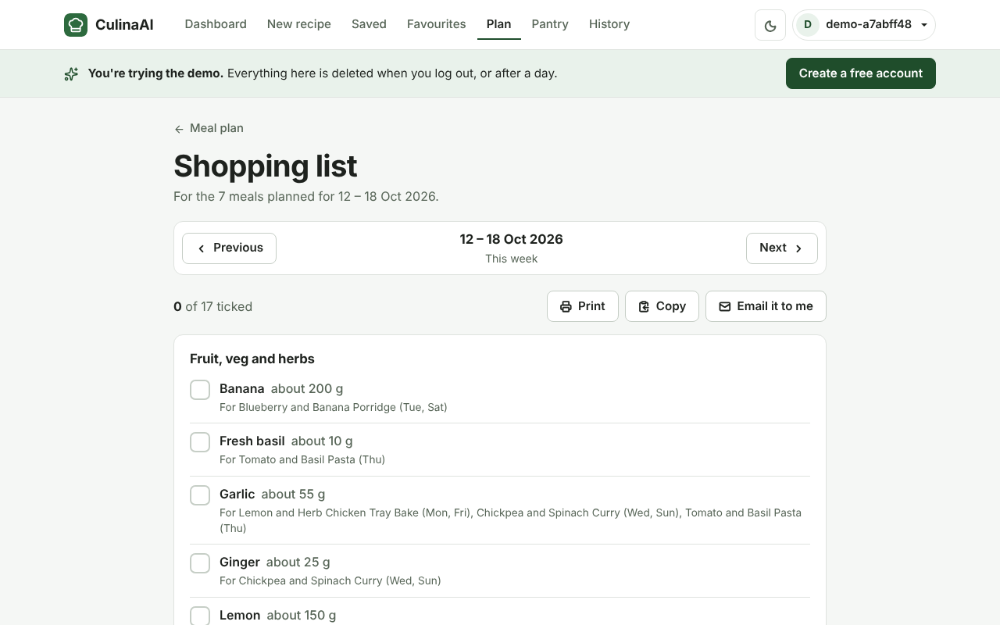
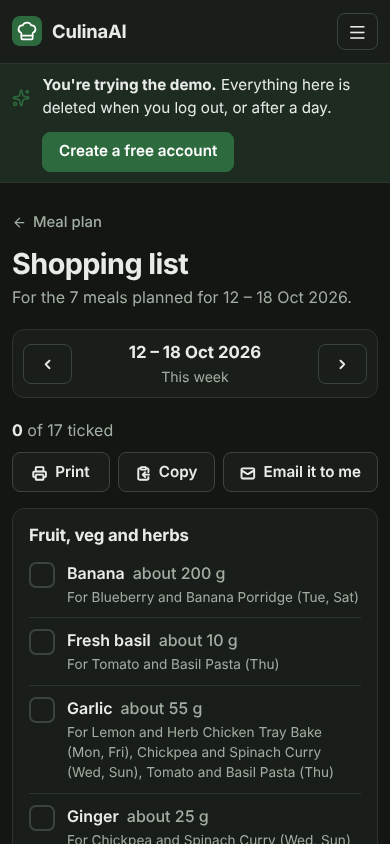
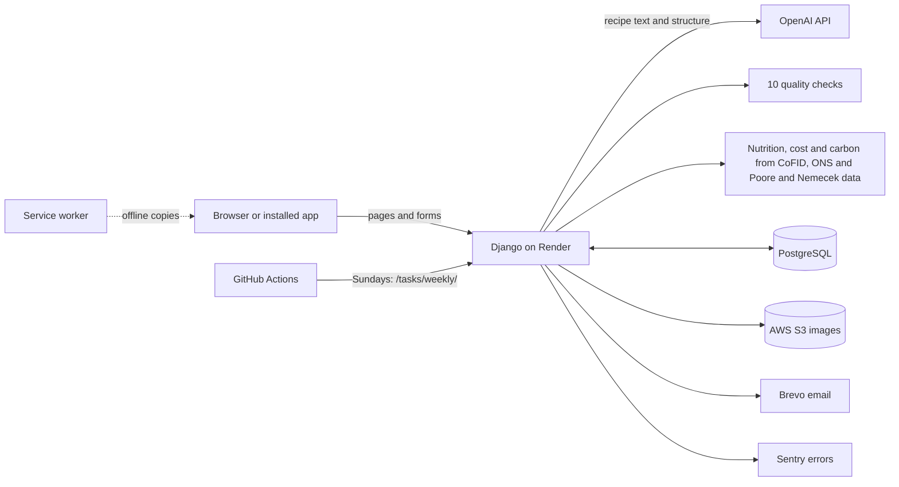

# CulinaAI


CulinaAI makes a recipe from the food you already have, for the people you're cooking for and the things they can't eat. The AI writes the recipe; code then checks it against your allergies, diet, ingredients, time and equipment, and works out the nutrition, cost and carbon from UK food data rather than trusting the AI's numbers.

**Live site: [culinaai.onrender.com](https://culinaai.onrender.com)**. Press **Try the demo** on the home page to look around without signing up. The demo account comes with recipes, a pantry and a week's meal plan already in it.

It runs on a free hosting plan, so the first page can take up to a minute to load if nobody has used it for a while.



## What it does

You type in your ingredients (or pick them from your pantry, or take a photo of your fridge), choose a meal style and anything you need to avoid, and get a recipe in about a minute. Your diet and allergies are saved on your profile and filled in every time.

Each recipe page shows:

- the recipe, laid out like a cookbook, with a summary of the checks it passed;
- energy, fat, saturates, sugars and salt per serving with UK traffic-light colours, plus cost and carbon per serving;
- the UK's 14 allergens found in the ingredients, with warnings for hidden ones (some pesto contains cashews, for example);
- "One dish, three ways": the same dish made cheaper, healthier or greener by swapping up to three ingredients, with the difference worked out;
- quick changes (healthier, cheaper, quicker, vegetarian, spicier, simpler, or your own words), shown next to the original before you save;
- a cooking mode with step timers and hands-free voice commands, and a cooking assistant for questions about the recipe.

Around the recipes:

- **Meal plan and shopping list.** Put saved recipes on days of the week, set the servings, and get one shopping list that adds up the same ingredient across recipes, scales it to your servings, and moves anything already in your pantry to a separate list.
- **Pantry.** Track what you have and when it goes off. The dashboard shows what needs using up and which of your saved recipes use it.
- **Sunday email** (opt-in): what goes off that week and next week's plan.
- **Works on a phone and offline.** It can be installed to the home screen. The shopping list, meal plan, recipes and cooking mode you've opened still work with no signal, and ticks made offline are sent when you're back online.
- **Accounts.** Saved recipes, favourites, history, sharing with other cooks, light and dark mode, email confirmation, and the option to download all your data or delete your account.

## How the AI is kept in check

For a recipe, the AI (OpenAI `gpt-4.1-mini`) writes the text, and a second small AI call reads the finished recipe into a fixed JSON structure: each ingredient with a weight in grams. Everything after that is done by code. Where the AI does suggest something later (ideas for ingredient swaps), the code checks each idea against the food data and the user's diet and allergies before it's shown.

**Ten quality checks** run on every recipe before you see it:

| Check | What it looks for |
|---|---|
| Allergy Safety | Anything you said to avoid, including the foods in a group (almonds and cashews for "tree nuts") |
| Diet Compliance | Meat, fish or animal products in vegetarian or vegan recipes, and other diet rules |
| Ingredient Match | That the recipe actually uses what you said you have |
| Recipe Structure | Title, ingredients with amounts, numbered steps, time and servings |
| Cooking Time Match | That the method fits the time you gave |
| Equipment Compatibility | No equipment you didn't select |
| Difficulty Match | Steps and techniques that suit the difficulty you chose |
| Cuisine and Nutrition Relevance | That it fits the cuisine and nutrition goal you asked for |
| Health Claims | No medical or health claims in the text |
| Explanation Consistency | For a well-known dish, every classic ingredient left out has a reason the code can confirm |

If a recipe fails, the reason is sent back to the AI and it tries again, up to three attempts in all. If it still fails, a safe fallback recipe is shown instead of an unsafe one. The checks are in [`backend/recipes/recipe_quality_engine.py`](backend/recipes/recipe_quality_engine.py).

**Numbers come from data, not the AI:**

| Figure | Source |
|---|---|
| Nutrition and traffic lights | CoFID 2021 (UK food composition data, about 2,750 foods) plus a few USDA entries for common ingredients it lacks; FSA front-of-pack levels |
| Cost per serving | ONS average prices and Tesco, Sainsbury's and Morrisons prices |
| Carbon per serving | Poore & Nemecek (2018), global averages per kg of food |
| Cuisine check | Signature ingredients by region from Ahn et al. (2011) |

[`docs/health_and_quality_checks.md`](docs/health_and_quality_checks.md) explains each panel and check in more detail.

**Cost and abuse limits.** Each account gets 20 AI recipes or changes and 50 cooking questions a day (both configurable). New accounts must confirm their email before using the AI. Demo accounts can't use the AI or send email, and are deleted after a day.

## Screenshots

| | |
|---|---|
|  |  |
|  |  |
|  |  |

## Tech stack

| Part | What's used |
|---|---|
| Backend | Python 3.12, Django 6, PostgreSQL |
| Frontend | Django templates, Bootstrap 5, plain JavaScript, a service worker for offline use |
| AI | OpenAI API: `gpt-4.1-mini` for recipes and structure, a vision model for fridge photos, an image model for recipe pictures |
| Hosting | Render (web service), AWS S3 (images), Brevo (email), Sentry (error tracking) |
| CI and jobs | GitHub Actions: the tests on every pull request and push to `main`, and the weekly email job |

## Architecture



The views are split by part of the site in `backend/recipes/` (`generate_views.py`, `saved_views.py`, `meal_plan_views.py`, `pantry_views.py` and so on), with the logic in services such as `insight_service.py`, `meal_plan_service.py` and `recipe_quality_engine.py`.

## Testing and evaluation

- **376 automated tests** (Django `TestCase`) cover generating, checking, changing and saving recipes, the nutrition engine, the meal plan and shopping list, accounts, limits, the demo, the weekly email and offline support. The AI is always replaced with a stand-in during tests, so running them never calls OpenAI. They run on GitHub Actions for every pull request and every push to `main`.
- `node scripts/test_voice_commands.js` checks the cooking-mode voice commands (362 phrases).
- **Benchmark:** 30 fixed recipe requests across six cuisines, run through the real pipeline with `python manage.py run_benchmark`, and reported with `python manage.py evaluate`. In the second full run, all 30 recipes passed the checks on the first try, none needed the fallback, and 28 of 30 had every ingredient matched to the food data. "Everyday healthy" was met by 4 of the 6 recipes that asked for it. What each run found and what was changed is written up in [`docs/evaluation/README.md`](docs/evaluation/README.md).

## Running it locally

You need Python 3.12 and PostgreSQL.

```bash
git clone https://github.com/SumitYadav2003/culinaai.git
cd culinaai

python -m venv venv
source venv/bin/activate        # Windows: .\venv\Scripts\Activate.ps1
pip install -r requirements.txt

cp .env.example .env            # then fill it in (see below)

cd backend
python manage.py migrate
python manage.py load_food_data # nutrition, price and carbon data
python manage.py createsuperuser
python manage.py test
python manage.py runserver
```

In `.env`, set `DEBUG=True`, a `SECRET_KEY`, your database details (`DB_NAME`, `DB_USER`, `DB_PASSWORD`, `DB_HOST`, `DB_PORT`) and `OPENAI_API_KEY`. Email settings are only needed to send real emails. The optional settings (daily limits, demo, Sentry, the weekly job) are listed at the bottom of [`.env.example`](.env.example) with their defaults.

## Background

CulinaAI started as my MSc Advanced Computer Science dissertation at the University of Leicester (June to September 2026). The dissertation version met its 29 functional and 10 non-functional requirements and passed 64 structured test scenarios, as documented in the report in `reports/`. That version had 8 quality checks and no nutrition engine. The nutrition, cost and carbon data, the two extra checks, the meal plan, offline support, the demo and most of the automated tests were added afterwards.

## Author

**Sumit Yadav**, MSc Advanced Computer Science, University of Leicester
[LinkedIn](https://linkedin.com/in/yadavsumit2003) · [GitHub](https://github.com/SumitYadav2003)
